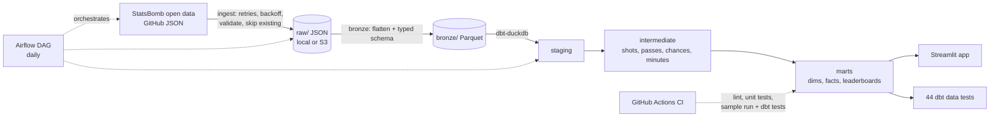

# Pitchline ⚽

**An end-to-end data pipeline that answers one question: who creates the most dangerous chances in international soccer?**

Raw match-event data goes in. A tested dbt warehouse and a small app come out.
Built with Python, AWS S3 (optional), Parquet, dbt, DuckDB, Airflow, GitHub Actions and Streamlit.


## What it answers

- **Who creates the best chances?** Ranked by *xG assisted per 90*: the expected-goals value of the shots a player's passes set up, adjusted for minutes played.
- **Where do they create from?** A pitch map of every pass that led to a shot.
- **Did results match the chances?** Goals scored vs. expected goals for every team.
- **Can I trust the numbers?** A data-health page shows the last pipeline run and the dbt test results.

On the 2022 World Cup (players with at least 300 minutes), Antoine Griezmann and Raphinha lead on xG assisted per 90, with Lionel Messi third; by total volume, Griezmann is first and Messi second.

## Architecture



## Scale (as built)

| | |
|---|---|
| Matches | 262 (World Cups 2018 and 2022, Euros 2020 and 2024, Copa América 2024) |
| Events | 943,374 |
| Shots | 6,619 (4,637 set up directly by a pass) |
| Player-match rows | 7,960 |
| dbt | 16 models, 44 data tests, all passing |
| Speed | Raw to Parquet in about 18 s; full dbt build (models and tests) in about 4 s |

## Data quality: what is actually tested

The tests are written to catch the failures that really happen in pipelines:

- **Reconciliation:** goals rebuilt from shot events (plus own goals) must equal the official scoreline for every match. It proves nothing was lost or double counted between ingest and the marts.
- **Completeness:** every match must have events and a full 22-player starting lineup.
- **Validity:** xG must be between 0 and 1; completed passes can't exceed passes; a team can never have more than 11 players' worth of minutes.
- **Integrity:** unique keys, not-null keys, and foreign keys between facts and dimensions.
- **Early warning:** a warning (not a failure) when a team's total minutes fall well short, which usually means a red card or a lineup gap.

I checked that these tests *fail* when they should by deliberately deleting a match's events and by corrupting an xG value; both were caught.

## Design decisions

| Decision | Why |
|---|---|
| **Rerun-safe ingest** | Existing files are skipped and writes are atomic, so a rerun after a crash never duplicates or half-writes data. |
| **Retries with exponential backoff, validation before writing** | The source is a free public host. A bad or empty response is rejected instead of saved. |
| **One storage interface, two backends** | The same code runs on a laptop or in S3 (`PITCHLINE_ROOT=s3://bucket/prefix`). |
| **Parquet bronze layer with an explicit schema** | The raw JSON is deeply nested; flat, typed columns make the SQL layer simple and fast. |
| **dbt on DuckDB** | A real warehouse workflow (models, tests, docs, lineage) with no server and no cost. The S3 profile reads Parquet straight from a bucket. |
| **Staging as tables, not views** | An early version used views over relative Parquet paths and broke whenever queried from another folder. Tables make the `.duckdb` file self-contained. |
| **dbt and the pipeline in their own virtualenv inside the Airflow image** | Keeps dbt's dependencies from clashing with Airflow's pinned ones. |
| **Summary task runs even if dbt fails** | The health page always reflects the latest run, including failures. |

## Run it

```bash
python -m venv .venv && source .venv/bin/activate
make setup          # install dependencies
make all            # ingest -> bronze -> dbt build + tests -> health summary
make app            # open the Streamlit app
```

Quick version (3 matches, what CI runs): `make sample`.
Run `make help` for every target, and `make docs` for the dbt lineage graph.

**Using S3 instead of local files:** set `PITCHLINE_ROOT=s3://YOUR-BUCKET/pitchline` and
`PITCHLINE_BRONZE=s3://YOUR-BUCKET/pitchline/bronze`, make sure your AWS credentials are available,
and run dbt with `--target s3`.

**Airflow (Docker):**
```bash
echo AIRFLOW_UID=$(id -u) > orchestration/.env
docker compose -f orchestration/docker-compose.yml up --build   # UI on http://localhost:8080
```
The DAG `pitchline_daily` runs `ingest_raw -> build_bronze -> dbt_build -> dbt_summary` every day at 09:00 UTC.

## Project layout

```
config/            which competitions to load
src/pitchline/     ingest, bronze (Parquet), storage (local/S3), health, CLI
dbt/               staging -> intermediate -> marts, generic + singular tests
orchestration/     Airflow DAG, Dockerfile, docker-compose
app/               Streamlit app
tests/             unit tests (ingest retries, idempotency, S3 via moto, bronze, DAG shape, app smoke)
.github/workflows/ CI: lint, tests, sample pipeline with all dbt tests, DAG import check
```

## Known limitations (and what I'd do next)

- **Minutes are approximate.** Computed from the starting XI and substitutions; red cards aren't modelled.
- **Open data only covers selected competitions.** Widening the warehouse is one line in `config/sources.yml`, but not every league or season is available for free.
- **"Progressive pass" is a simplified definition** (documented in `int_passes.sql`), not a provider standard.
- **Next:** incremental dbt models once the data grows, a published `dbt docs` site, and a data-freshness alert from Airflow.

## Data and credit

Match data is [StatsBomb Open Data](https://github.com/statsbomb/open-data). Please read their licence and user agreement
before publishing analysis built on it; it requires crediting StatsBomb as the source.

---

## Status: Pitchline Live (work in progress)

Pitchline is being extended from a one-tournament demo into a multi-league pipeline that tracks
player shot and chance creation totals across years and updates as matches finish.

**Live site (Shotcast):** https://amir-mirkazemi.github.io/pitchline-live/ (per-competition leaderboards for
shots on target, goals, assists and on-target-per-90, team pages, player pages with shot maps, player search,
and a data-quality page; rebuilt automatically from the stored matches by `.github/workflows/site.yml`,
code in `src/pitchline/site.py`). ESPN reports shot locations in two different coordinate formats; the
shot maps detect the format per match.

**Built and tested**
- ESPN commentary parser: one row per shot with location (when ESPN provides it), body part, situation,
  assister. Each match is reconciled against ESPN's own boxscore total shots and flagged `ok` or
  `mismatch`; mismatches are logged with the lines that explain them. On a live run over all 110
  Premier League matches from 2025-08-01 to 2025-11-15, 110 of 110 reconcile on total shots
  (the first live run reconciled 4 of 15; the gap was ESPN data quirks, fixed one by one with tests).
  Across the three Premier League seasons stored so far (1,240 matches), 1,234 reconcile (99.5%). Of the
  other 6, one has no commentary at ESPN and five (all from 2023-24) differ from ESPN's own totals by
  one or two shots. They stay flagged `mismatch` in the data and are never hidden. For some older matches
  ESPN's boxscore is empty (every statistic reads 0), so those are checked against ESPN's per-player
  stats instead (the match file records which source was used).
  Known limit: ESPN counts some blocked shots as on target in its own stats, so Shots on Target uses
  ESPN's per-player roster stats, not the commentary.
- xG estimator calibrated to StatsBomb xG, validated leave-one-competition-out
  (competition totals within about 3%, about 0.04 error per shot).
- Player identity by ESPN athlete id (two players with the same name stay separate) and minutes played
  from stored lineups, with a re-download mode (`--upgrade`) that adds both to older matches.
- Static website generated from the stored matches (competition leaderboards, player search, method and
  data-quality page) and deployed with GitHub Pages.
- Resumable, rate-limit-aware backfills (ESPN, and API-Football for the Saudi Pro League)
  that run on a schedule in GitHub Actions and write to S3.

**Not built yet**
- Running per-player totals in dbt, the "Danger" ranking, and the live poller.
- Validation of ESPN coordinates against StatsBomb on the *same* matches.

**Data notes**
- ESPN endpoints are unofficial. This repository contains code and tiny synthetic test fixtures only;
  no ESPN or API-Football data is committed or redistributed.
- Saudi Pro League data comes from API-Football's free plan (seasons 2022-2024) and has no shot
  locations, so it can only support a Shots on Target ranking, not the Danger ranking.
- StatsBomb open data is used under its attribution terms. Credit: StatsBomb.
