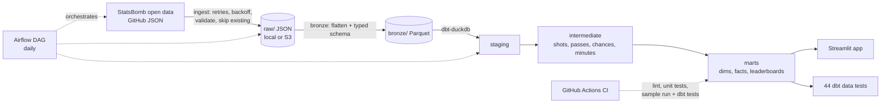

# Shotcast ⚽

**Live site: https://amir-mirkazemi.github.io/shotcast/**

Shotcast is a soccer data project built end to end: a nightly pipeline collects match data for the big European leagues, MLS, the Saudi Pro League and the World Cup and Euros, validates it, and rebuilds a public website that ranks shooters, shows where shots come from, forecasts shots on target, and publishes a scorecard of how those forecasts turn out.


What makes it more than a dashboard:

- **A data contract.** Every match file is checked against a Pydantic schema when written and again before the site is built; failures go to a quarantine folder with reasons and never reach a page.
- **A tested warehouse.** Matches load incrementally into DuckDB and dbt builds and tests the ESPN models nightly; the [health page](https://amir-mirkazemi.github.io/shotcast/health.html) shows the latest run.
- **Models that have to earn their place.** Forecasts use walk-forward testing and a paired bootstrap; a model is used only if it beats the baseline in most test periods and its gain holds up. The site says so when it does not. See the [model card](docs/MODEL_CARD.md).
- **Validated expected goals.** Shot-level xG is tested the same way, cross-fitted so no shot is scored by a model that saw its match, and feeds player xG, xA and percentile profiles.
- **A public scorecard.** Forecasts are stored before matches are played and compared with what happened.


The screenshots are refreshed from the live site by the `screenshots` workflow (Actions tab, run manually).

The rest of this README starts with the original StatsBomb pipeline this grew out of, then covers the website.

---

# Original project: StatsBomb chance-creation pipeline

**An end-to-end data pipeline that answers one question: who creates the most dangerous chances in international soccer?**

Raw match-event data goes in. A tested dbt warehouse and a small app come out.
Built with Python, AWS S3 (optional), Parquet, dbt, DuckDB, Airflow, GitHub Actions and Streamlit.


## What it answers

- **Who creates the best chances?** Ranked by *xG assisted per 90*: the expected-goals value of the shots a player's passes set up, adjusted for minutes played.
- **Where do they create from?** A pitch map of every pass that led to a shot.
- **Did results match the chances?** Goals scored vs. expected goals for every team.
- **Can I trust the numbers?** A data-health page shows the last pipeline run and the dbt test results.

On the 2022 World Cup (players with at least 300 minutes), Antoine Griezmann and Raphinha lead on xG assisted per 90, with Lionel Messi third; by total volume, Griezmann is first and Messi second.

## Architecture



## Scale (as built)

| | |
|---|---|
| Matches | 262 (World Cups 2018 and 2022, Euros 2020 and 2024, Copa América 2024) |
| Events | 943,374 |
| Shots | 6,619 (4,637 set up directly by a pass) |
| Player-match rows | 7,960 |
| dbt | 16 models, 44 data tests, all passing |
| Speed | Raw to Parquet in about 18 s; full dbt build (models and tests) in about 4 s |

## Data quality: what is actually tested

The tests are written to catch the failures that really happen in pipelines:

- **Reconciliation:** goals rebuilt from shot events (plus own goals) must equal the official scoreline for every match. It proves nothing was lost or double counted between ingest and the marts.
- **Completeness:** every match must have events and a full 22-player starting lineup.
- **Validity:** xG must be between 0 and 1; completed passes can't exceed passes; a team can never have more than 11 players' worth of minutes.
- **Integrity:** unique keys, not-null keys, and foreign keys between facts and dimensions.
- **Early warning:** a warning (not a failure) when a team's total minutes fall well short, which usually means a red card or a lineup gap.

I checked that these tests *fail* when they should by deliberately deleting a match's events and by corrupting an xG value; both were caught.

## Design decisions

| Decision | Why |
|---|---|
| **Rerun-safe ingest** | Existing files are skipped and writes are atomic, so a rerun after a crash never duplicates or half-writes data. |
| **Retries with exponential backoff, validation before writing** | The source is a free public host. A bad or empty response is rejected instead of saved. |
| **One storage interface, two backends** | The same code runs on a laptop or in S3 (`SHOTCAST_ROOT=s3://bucket/prefix`). |
| **Parquet bronze layer with an explicit schema** | The raw JSON is deeply nested; flat, typed columns make the SQL layer simple and fast. |
| **dbt on DuckDB** | A real warehouse workflow (models, tests, docs, lineage) with no server and no cost. The S3 profile reads Parquet straight from a bucket. |
| **Staging as tables, not views** | An early version used views over relative Parquet paths and broke whenever queried from another folder. Tables make the `.duckdb` file self-contained. |
| **dbt and the pipeline in their own virtualenv inside the Airflow image** | Keeps dbt's dependencies from clashing with Airflow's pinned ones. |
| **Summary task runs even if dbt fails** | The health page always reflects the latest run, including failures. |

## Run it

```bash
python -m venv .venv && source .venv/bin/activate
make setup          # install dependencies
make all            # ingest -> bronze -> dbt build + tests -> health summary
make app            # open the Streamlit app
```

Quick version (3 matches, what CI runs): `make sample`.
Run `make help` for every target, and `make docs` for the dbt lineage graph.

**Using S3 instead of local files:** set `SHOTCAST_ROOT=s3://YOUR-BUCKET/pitchline` and
`SHOTCAST_BRONZE=s3://YOUR-BUCKET/pitchline/bronze` (the project was first called Pitchline; the S3 prefix keeps that name so existing data stays where it is), make sure your AWS credentials are available,
and run dbt with `--target s3`.

**Airflow (Docker):**
```bash
echo AIRFLOW_UID=$(id -u) > orchestration/.env
docker compose -f orchestration/docker-compose.yml up --build   # UI on http://localhost:8080
```
The DAG `shotcast_daily` runs `ingest_raw -> build_bronze -> dbt_build -> dbt_summary` every day at 09:00 UTC.

## Project layout

```
config/            which competitions to load
src/shotcast/     ingest, bronze (Parquet), storage (local/S3), health, CLI, site.py + templates/ + static/ (website)
dbt/               staging -> intermediate -> marts, generic + singular tests
orchestration/     Airflow DAG, Dockerfile, docker-compose
app/               Streamlit app
tests/             unit tests (ingest retries, idempotency, S3 via moto, bronze, DAG shape, app smoke); tests/e2e = Playwright
.github/workflows/ CI: lint, tests, sample pipeline with all dbt tests, DAG import check
```

## Known limitations (and what I'd do next)

- **Minutes are approximate.** Computed from the starting XI and substitutions; red cards aren't modelled.
- **Open data only covers selected competitions.** Widening the warehouse is one line in `config/sources.yml`, but not every league or season is available for free.
- **"Progressive pass" is a simplified definition** (documented in `int_passes.sql`), not a provider standard.
- **Next:** incremental dbt models once the data grows, a published `dbt docs` site, and a data-freshness alert from Airflow.

## Data and credit

Match data is [StatsBomb Open Data](https://github.com/statsbomb/open-data). Please read their licence and user agreement
before publishing analysis built on it; it requires crediting StatsBomb as the source.

---

## Status: Shotcast (work in progress)

Shotcast is being extended from a one-tournament demo into a multi-league pipeline that tracks
player shot and chance creation totals across years and updates as matches finish.

**Live site (Shotcast):** https://amir-mirkazemi.github.io/shotcast/
- Leaderboards per competition (on target, goals, assists, on target per 90), team pages, player pages with
  shot maps, player search, and an all-competitions "Best of the best" top 10 (unadjusted counts, labeled).
- Near-live scores for every competition, refreshed about every 15 minutes (`live.yml`, `live.py`).
- Forecasts of shots on target for the next matchday and the season: Poisson models with a time-ordered
  backtest against a plain baseline, saved before matches and graded afterwards on a public scorecard
  (`forecast.py`, `forecast.yml`). If no model beats the baseline, the page says so and uses the baseline.
- "Call your shot": fans pick season leaders; picks stay in the browser (localStorage).
- Link-preview images for sharing are generated at build time (`cards.py`).
- Rebuilt automatically: nightly download of recent matches -> forecast -> site build.
- ESPN reports shot locations in two coordinate formats; the shot maps detect the format per match.

**Built and tested**
- ESPN commentary parser: one row per shot with location (when ESPN provides it), body part, situation,
  assister. Each match is reconciled against ESPN's own boxscore total shots and flagged `ok` or
  `mismatch`; mismatches are logged with the lines that explain them. On a live run over all 110
  Premier League matches from 2025-08-01 to 2025-11-15, 110 of 110 reconcile on total shots
  (the first live run reconciled 4 of 15; the gap was ESPN data quirks, fixed one by one with tests).
  Across the three Premier League seasons stored so far (1,240 matches), 1,234 reconcile (99.5%). Of the
  other 6, one has no commentary at ESPN and five (all from 2023-24) differ from ESPN's own totals by
  one or two shots. They stay flagged `mismatch` in the data and are never hidden. For some older matches
  ESPN's boxscore is empty (every statistic reads 0), so those are checked against ESPN's per-player
  stats instead (the match file records which source was used).
  Known limit: ESPN counts some blocked shots as on target in its own stats, so Shots on Target uses
  ESPN's per-player roster stats, not the commentary.
- `xg_model.py`: an earlier xG estimator calibrated to StatsBomb xG (not used by the website).
- Player identity by ESPN athlete id (two players with the same name stay separate) and minutes played
  from stored lineups, with a re-download mode (`--upgrade`) that adds both to older matches.
- Static website generated from the stored matches (competition leaderboards, player search, method and
  data-quality page) and deployed with GitHub Pages.
- Resumable, rate-limit-aware backfills (ESPN, and API-Football for the Saudi Pro League)
  that run on a schedule in GitHub Actions and write to S3.

**Not built yet**
- Running per-player totals in dbt and the "Danger" ranking.
- Validation of ESPN coordinates against StatsBomb on the *same* matches.

**Data notes**
- ESPN endpoints are unofficial and undocumented. This repository contains code and tiny synthetic test fixtures
  only; no ESPN or API-Football data is committed or redistributed. The pipeline stores parsed, derived match
  records (teams, score, player statistics, shot events) in a private S3 bucket and does not keep or publish raw
  ESPN responses. The website shows derived statistics for a non-commercial portfolio project, uses no logos or
  photographs, and is not affiliated with ESPN or any league. Rights holders can ask for changes or removal
  through the contact links on the site's About page.
- Saudi Pro League data comes from API-Football's free plan (seasons 2022-2024) and has no shot
  locations, so it can only support a Shots on Target ranking, not the Danger ranking.
- StatsBomb open data is used under its attribution terms. Credit: StatsBomb.


## Forecast model

The Forecast page predicts shots on target per player and match, and is built to be checked rather than believed.
Details and limits are in [`docs/MODEL_CARD.md`](docs/MODEL_CARD.md).

| Part | Code | What it does |
|---|---|---|
| Walk-forward validation | `mlcore.py`, `forecast.train_and_backtest` | Four successive test periods, each predicted by a model trained only on earlier matches. |
| Candidates | `mlcore.fit` | Poisson regression, scikit-learn boosting and LightGBM (Poisson loss), against a baseline of own recent rate x minutes. |
| Gate | `mlcore.paired_bootstrap` | A model is used only if it wins most periods and its gain stays positive when whole matches are resampled. Otherwise the baseline is used and the page says so. |
| Spread | `mlcore.estimate_alpha` | Negative binomial dispersion measured out of sample, giving the chance of 1+ and 2+ on target. |
| Season ranges | `forecast.future_draws` | Rate uncertainty plus match noise. In simulation they cover 85-90% of outcomes for a nominal 80%; the older plain-Poisson ranges covered 62-87%. |
| Scorecard | `forecast.scorecard` | Saved forecasts graded after the matches: error, bias, Brier score and calibration of the probabilities. |

`tests/test_ml.py` checks the maths on simulated data with known truth: the dispersion is recovered, probabilities are calibrated, test periods never overlap or look ahead, a useless model is rejected, and the page still renders forecasts saved in the older format.

## Data quality and warehouse

The JSON match files in S3 are the system of record. Three layers sit on top of them:

| Layer | Code | What it guarantees |
|---|---|---|
| Data contract | `schemas.py` (Pydantic) | Every match file is validated when it is written and again before the site is built. A file that fails goes to `espn/quarantine/` with its reasons and is left out of every page. |
| Warehouse | `warehouse_espn.py`, `dbt/models/espn` | Matches are loaded into DuckDB incrementally: each file has a fingerprint (S3 ETag) taken from the listing, so unchanged files are never downloaded. dbt builds staging models, `dim_espn_match/team/player`, `fct_espn_player_match` (one row per player per match), `fct_espn_shot` and `mart_espn_player_season`. |
| Observability | `logs.py`, `health_check.py`, `data_quality.yml` | JSON logs in CI, one run record per job in `runs/`, and a daily check that fails the workflow (GitHub emails the owner) when no competition has a new match for 4 days, a file fails the contract, or a dbt test fails. The results are published on the site's [Data health](https://amir-mirkazemi.github.io/shotcast/health.html) page. |

dbt runs 25 tests on the ESPN models: unique and not-null keys, relationships between facts and dimensions, accepted shot outcomes, and four singular tests. Two fail the run: shots on target never above shots, and minutes between 0 and 150. Two only warn, because they flag problems in ESPN's own feed rather than in the pipeline: a team's players scoring more goals than the team's score, and repeated play ids inside one match. `tests/test_dbt_espn.py` runs the real dbt build on a fixture warehouse, including a case where bad data must make a test fail. `tests/test_warehouse_espn.py` checks that the warehouse totals equal the numbers the site shows.

```
make espn      # load new matches into DuckDB, run the ESPN dbt models and tests
make validate  # check every stored match file against the data contract
make check     # data health report, exit code 1 when something is wrong
```

Not done on purpose: the nightly job restores the previous DuckDB file from S3, so it is incremental across runs, but the site itself is still built straight from the JSON files, not from the warehouse. Moving the site's queries onto the dbt marts is the next step once the marts have run in production for a while.

## Website architecture

The site is static files on GitHub Pages: no server, no database, no framework. It is rebuilt after every nightly run.

```
S3 (one JSON per match) -> site.py (prepares data) -> Jinja2 templates -> static HTML
                                                  \-> static/ (style.css, app.js, charts.js, fonts, icons)
```

| Concern | Choice | Why |
|---|---|---|
| Markup | Jinja2 templates in `src/shotcast/templates/` | HTML lives in templates; `site.py` only prepares plain data (dicts and lists) |
| Styling | One `style.css`, navy and emerald theme, light mode via a toggle | No build step, no CSS framework |
| Type and icons | Inter (self-hosted) and a Lucide SVG sprite | No third-party requests at runtime |
| Charts | Apache ECharts (self-hosted, loaded only on player pages) for breakdowns; hand-built SVG for shot maps | Interactive tooltips where it helps, crisp SVG where positions matter |
| Behaviour | Small vanilla JS files, one per page that needs it | `app.js` is 2.6 KB gzipped |
| Tests | Pytest for the data, Playwright for the browser (`tests/e2e`) | Search, theme, tabs, news filters, charts, mobile menu, no horizontal scroll |

Frontend budget (gzipped): `style.css` 5.2 KB, `app.js` 2.6 KB, Inter 48 KB, ECharts 334 KB on player pages only.

Engineering decisions worth knowing:
- Shot-map dots, avatars (a generic shirt in the club's main colours) and stat notes are generated from data. No
  player photos, crests or sponsor logos are used.
- Fonts, icons and charts are vendored so a page view sends nothing to a third party.
- News stories are computed from the stored matches with plain statistics, not written by a language model.
- The browser tests caught a real bug (the `hidden` attribute losing to a `display` rule), which is why they exist.

Run the browser tests locally: `pip install playwright && playwright install chromium && pytest tests/e2e`.

To add screenshots: open the deployed site, save images into `docs/img/` and reference them here. (Screenshots of a
synthetic sample would show made-up numbers next to real player names, so none are committed.)

## Newest additions

- **Shot Notes and News**: stat stories (hat-tricks, form, shot-heavy matches, per-90 and accuracy leaders) written
  automatically from the stored matches (`notes.py`), with competition, story-type and date filters.
- **Players to watch**: cards with a club-colour shirt avatar, a mini shot map and big numbers.
- **Match Day**: live scores with the model's pre-match shots-on-target forecast under each fixture.

### Site features

| Feature | Where | How it works |
|---|---|---|
| Player comparison | `compare.html` | `compare.json` (index) + `shots/{id}.json`, all built at publish time; the pair lives in the URL |
| Season and team filters | competition pages | `data/{league}.json` holds per-season, per-team rows; `league.js` re-aggregates in the browser |
| Player profile | `p-*.html` | rolling 5- and 10-match form, career by season, club and competition, club stints read from stored matches |
| Match report | `m-*.html` | result, team totals, shot maps, per-player table; forecast vs actual when a forecast was saved before kickoff |

Season boundaries roll over on 1 July. Club stints come from the stored match files, so they show moves inside the stored dates, not transfers. A player's current club is the team in his newest stored match.
